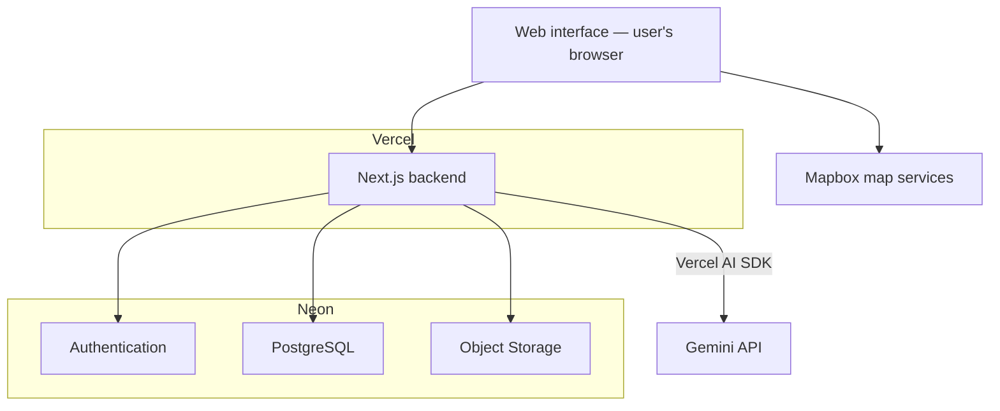
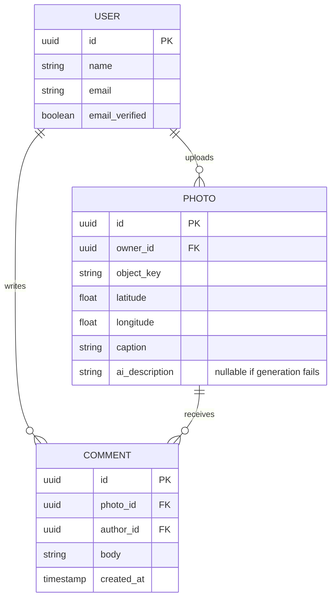
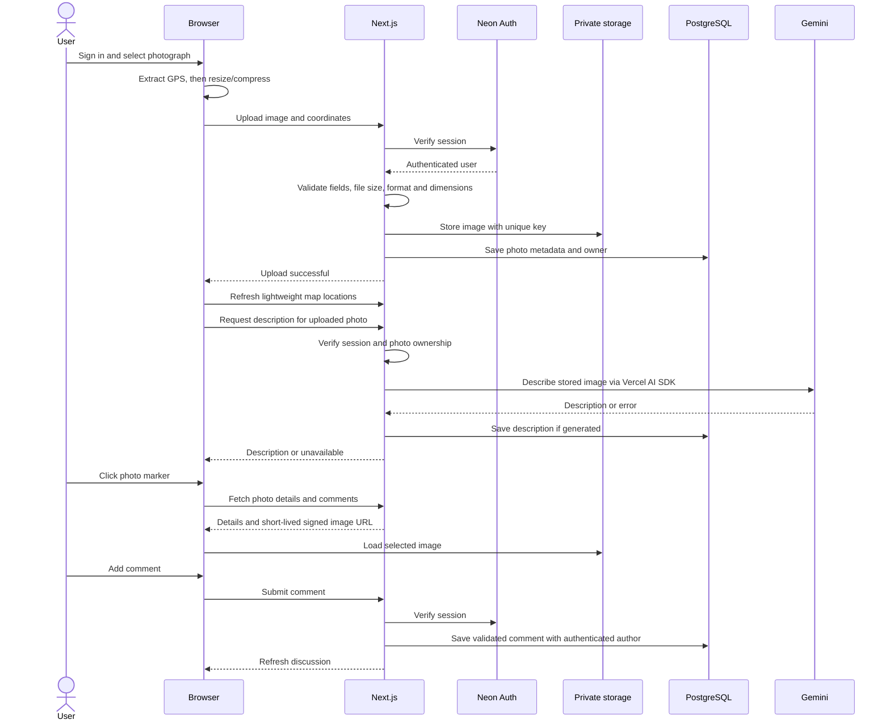

# GeoTagged Photos

Upload geotagged photographs, generate descriptions with Gemini, explore them on a map, and discuss them through comments.

## Setup

Requires [mise](https://mise.jdx.dev/), a Neon project with Auth and a **private** Object Storage bucket, a Mapbox public token, and a Google Gemini API key with access to `gemini-3.5-flash-lite`.

### Run locally

```bash
git clone https://github.com/Ret2Hell/geotagged-photos.git
cd geotagged-photos
mise trust
mise install
mise run install
cp .env.example .env.local
```

Fill in every variable in `.env.local` using `.env.example`:

- Use database, Auth, and storage credentials from the **same Neon branch**. Enable email/password authentication before running migrations.
- Generate `NEON_AUTH_COOKIE_SECRET` with `openssl rand -base64 32`.
- Keep `.env.local` private; only `NEXT_PUBLIC_MAPBOX_TOKEN` is exposed to the browser.

```bash
mise run db:check
mise run db:migrate
mise run hooks
mise run dev
```

`db:migrate` creates the application tables and user references in the configured database. Open [localhost:3000](http://localhost:3000), create an account, and sign in. Upload a GPS-tagged JPEG up to 25 MiB to try the map, descriptions, and comments.

### Checks and deployment

Run `pn run lint`, `pn run typecheck`, and `pn run format:check`. Use `mise run build` for a production build, or `mise run start` to build and serve it locally.

For Vercel, import the repository and configure the variables from `.env.example` in the deployment environment. Apply migrations to that environment's Neon database before using the app. Add the exact deployment origin (for example, `https://your-app.vercel.app`) to Neon Auth's trusted origins and the Mapbox token's allowed URLs. Redeploy after changing environment variables.

## Stack

- **Application:** Next.js, React, TypeScript, Tailwind CSS, shadcn/ui.
- **Backend:** Next.js Route Handlers and Server Actions; Zod validation.
- **Data:** Neon PostgreSQL, Drizzle, managed Neon Auth, private Neon Object Storage.
- **Map and images:** Mapbox GL JS, react-map-gl, exifr for GPS.
- **AI:** Gemini through the Vercel AI SDK.
- **Deployment:** Vercel + Neon.

## Why Next.js and Neon?

I chose Next.js and Neon to keep development and deployment simple within the four-hour time limit. Next.js combines the frontend and backend in one deployable application, avoiding the setup and deployment overhead of a separate FastAPI, Express, or NestJS service. Neon provides managed PostgreSQL and built-in authentication powered by Better Auth, so I don't need to host a database or manage an authentication service myself. Together, they let me focus on the application's features rather than infrastructure.

## Architecture

One Next.js application, without a separate backend service. Authentication is required to view the map and photos, upload images, and add comments.



| Component                | Responsibility                                                                                                                               |
| ------------------------ | -------------------------------------------------------------------------------------------------------------------------------------------- |
| Web interface            | Lets users sign in, upload photographs, select photos on the map, and read or write comments. Extracts GPS and resizes images before upload. |
| Next.js backend          | Verifies sessions, validates uploads and comments, saves records, generates signed image URLs, and requests AI descriptions.                 |
| Neon Auth                | Manages user accounts and sessions through managed Better Auth.                                                                              |
| Neon PostgreSQL          | Stores photo coordinates, captions, object keys, AI descriptions, and comments.                                                              |
| Neon Object Storage      | Stores the image files in a private bucket; serves selected images through short-lived signed URLs.                                          |
| Mapbox                   | Supplies map styles and tiles; Mapbox GL JS renders the interactive map and clusters photo locations in the browser.                         |
| Gemini via Vercel AI SDK | Generates image descriptions for the backend to store.                                                                                       |

## Data model

Authentication tables remain managed by Neon Auth; the user fields below are a simplified view, not a separate application table. Store image object keys in PostgreSQL, not image binaries or expiring URLs.



## Upload-to-map workflow



## Performance

- **10,000 locations:** use a GeoJSON source, WebGL layers, and native clustering—not thousands of React markers. Fetch images/comments only on selection. Validate rendering with synthetic points, clearly separate from real photos.

## Time estimate

| Step                                                                          |           Minutes |
| ----------------------------------------------------------------------------- | ----------------: |
| Planning, architecture, and inspecting supplied image assets                  |                50 |
| Project setup, foundation, tooling, database/storage, early Vercel deployment |                30 |
| Authentication                                                                |                25 |
| Upload and GPS extraction                                                     |                30 |
| Map and clustering                                                            |                30 |
| Photo details and comments                                                    |                25 |
| Gemini image descriptions                                                     |                20 |
| End-to-end checks, lint/type/build, deployment fixes                          |                20 |
| Setup instructions and known limitations                                      |                10 |
| **Total**                                                                     | **240 (4 hours)** |
